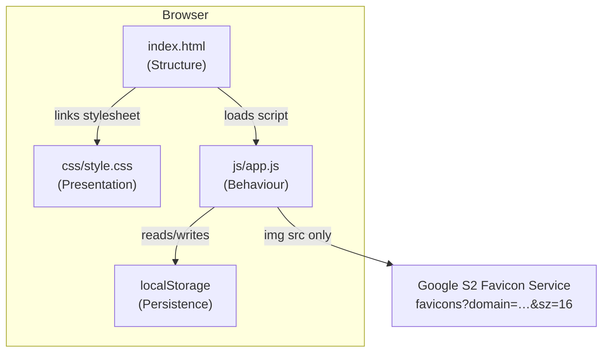

# Design Document

## Overview

The Life Dashboard is a single-page static web application. It has no build step, no server, and no third-party frameworks. A user opens `index.html` directly in a browser and all functionality runs client-side. All user data (name, theme preference, timer duration, tasks, and quick links) is persisted in the browser's `localStorage`. The only outbound network activity is the browser fetching favicon images from Google's S2 service as `` elements — no JavaScript-initiated network calls are made.

## Architecture

The application is split across three files, each responsible for one layer:

There is no module bundler, transpiler, or package manager. The script runs in a single `'use strict'` file with no IIFE wrapper; all variables are file-scoped.

## Components and Interfaces

### File Structure

| File | Role |
|---|---|
| `index.html` | Application shell; declares all widget markup and element IDs |
| `css/style.css` | Single stylesheet: design tokens, layout, widget styles, responsive breakpoints |
| `js/app.js` | Single script: all event handling, state management, localStorage I/O |

### HTML Structure

The document body carries the initial theme class `light`. Its top-level children are:

- **`<header class="topbar">`** — sticky top bar with three flex regions:
  - `.topbar-left`: `#greeting-text` span + `#user-name` span + `#edit-name-btn` icon button
  - `.topbar-center`: `#current-time` div + `#current-date` div
  - `.topbar-right`: `#theme-toggle` button
- **`#name-modal.modal.hidden`** — full-viewport backdrop + `.modal-box` containing `#name-input`, `#name-save-btn`, `#name-cancel-btn`
- **`<main class="grid">`** — CSS grid container with three `.card` sections:
  - `.timer-card`: `#timer-display`, timer controls row (Start / Stop / Reset), timer-settings row (`#pomodoro-minutes` + `#pomodoro-set`), `#timer-status`
  - `.todo-card`: `#todo-input` + `#todo-add-btn`, `#todo-list` ul, `#todo-empty`
  - `.links-card`: `#link-name-input` + `#link-url-input` + `#link-add-btn`, `#links-grid` div, `#links-empty`

### CSS Architecture

**Design token system** — `:root` defines custom properties for the light theme; `body.dark` overrides the colour and shadow tokens without touching spacing or radius:

| Token | Light value | Dark override |
|---|---|---|
| `--radius` | `14px` | — |
| `--gap` | `20px` | — |
| `--transition` | `0.25s ease` | — |
| `--bg` | `#f0f2f5` | `#0f1117` |
| `--surface` | `#ffffff` | `#1a1d27` |
| `--surface-alt` | `#f7f8fa` | `#22263a` |
| `--border` | `#e2e5eb` | `#2e3347` |
| `--text` | `#1a1d23` | `#e8eaf0` |
| `--text-muted` | `#6b7280` | `#8b92a8` |
| `--accent` | `#4f6ef7` | `#6c8aff` |
| `--accent-hover` | `#3a57e8` | `#5574f7` |
| `--accent-fg` | `#ffffff` | — |
| `--danger` | `#ef4444` | — |
| `--danger-hover` | `#dc2626` | — |
| `--success` | `#22c55e` | — |
| `--warning` | `#f59e0b` | — |
| `--shadow` | `0 2px 12px rgba(0,0,0,0.07)` | `0 2px 12px rgba(0,0,0,0.35)` |
| `--shadow-lg` | `0 8px 30px rgba(0,0,0,0.1)` | `0 8px 30px rgba(0,0,0,0.45)` |

**Button variants:**
- `.btn-primary` — accent fill, white text, 600 weight
- `.btn-secondary` — `--surface-alt` fill, border, normal text
- `.btn-ghost` — transparent, `--border` border, muted text
- `.icon-btn` — no border, emoji content, transparent background

**Layout:**
- `.topbar` — `position: sticky; top: 0; z-index: 100`; flex row with space-between, wraps on small screens
- `main.grid` — `display: grid; grid-template-columns: repeat(auto-fit, minmax(320px, 1fr)); max-width: 1300px; margin: 0 auto`

**Card component:** `.card` — `background: var(--surface)`, `border-radius: var(--radius)`, `border: 1px solid var(--border)`, `box-shadow: var(--shadow)`, hover elevates to `--shadow-lg`

**Timer display states:**
- Default — `color: var(--accent)`
- `.running` — `color: var(--success)` (green)
- `.finished` — `color: var(--warning)` (amber) + `pulse` keyframe animation (opacity 1 → 0.5 at 0.8 s, alternating infinite)

**To-do item states:**
- `.todo-item.done` — `opacity: 0.55`; `.todo-text` gains `text-decoration: line-through; color: var(--text-muted)`
- `.todo-edit-input` — replaces the `.todo-text` span during inline edit; styled with accent border

**Link chip:** `.link-chip` — pill shape (`border-radius: 50px`), `max-width: 220px`, flex row containing: 16×16 favicon ``, labelled `<a>`, delete `<button class="btn-delete">`

**Modal:** `position: fixed; inset: 0; z-index: 999`; `background: rgba(0,0,0,0.45)` with `backdrop-filter: blur(4px)`; `.modal.hidden` sets `display: none`

**Responsive breakpoint** (`max-width: 600px`): clock font-size reduced to 1.5 rem, timer display to 3 rem, topbar and grid padding reduced

### JavaScript Module Breakdown

The script is a single `'use strict'` file with no module system. Logical sections are ordered by dependency (helpers first, initialisation last in each section).

#### 6.1 Helpers

| Symbol | Signature | Purpose |
|---|---|---|
| `$` | `(id) → Element` | `document.getElementById` shorthand |
| `pad` | `(n) → string` | Zero-pads a single digit: `String(n).padStart(2, '0')` |
| `saveJSON` | `(key, value) → void` | `JSON.stringify(value)` → `localStorage.setItem` |
| `loadJSON` | `(key, fallback) → any` | `localStorage.getItem` → `JSON.parse` with try/catch; returns `fallback` on null or parse error |

#### 6.2 Theme Module

**State:** `isDark` boolean, initialised from `loadJSON('theme', false)`.

**Functions:**
- `applyTheme()` — `document.body.classList.toggle('dark', isDark)` / `toggle('light', !isDark)`; sets `themeToggle.textContent` to `'☀️'` (dark) or `'🌙'` (light).

**Events:** click on `#theme-toggle` — flips `isDark`, persists with `saveJSON`, calls `applyTheme()`.

**Initialisation:** `applyTheme()` called at module level.

#### 6.3 Clock & Greeting Module

**Constants:** `DAYS[7]` (full English day names), `MONTHS[12]` (full English month names).

**Functions:**
- `getGreeting(hour)` — returns `'Good morning'` (0–11), `'Good afternoon'` (12–16), `'Good evening'` (17–20), `'Good night'` (21–23).
- `updateClock()` — creates `new Date()`, writes `HH:MM:SS` to `#current-time`, writes `Weekday, Month D, YYYY` to `#current-date`, writes greeting to `#greeting-text`.

**Initialisation:** `updateClock()` called once immediately; `setInterval(updateClock, 1000)` drives subsequent updates.

#### 6.4 Custom Name Module

**State:** DOM references held in module scope: `nameModal`, `nameInput`, `nameSaveBtn`, `nameCancelBtn`, `editNameBtn`, `userNameSpan`.

**Functions:**
- `loadName()` — reads `'userName'` from localStorage (fallback `'Friend'`), writes to `#user-name`.

**Events:**
- `#edit-name-btn` click → removes `hidden` from modal; pre-fills `nameInput` with current name, or `''` when name is `'Friend'`; focuses input.
- `#name-save-btn` click → trims value; if non-empty: persists to `localStorage`, updates span; always adds `hidden` to modal.
- `#name-cancel-btn` click → adds `hidden` to modal.
- `nameInput` keydown `Enter` → triggers save button click; keydown `Escape` → triggers cancel button click.
- `nameModal` click on backdrop (target === modal element) → triggers cancel button click.

**Initialisation:** `loadName()` called at module level.

#### 6.5 Focus Timer Module

**State:**

| Variable | Type | Initial value |
|---|---|---|
| `pomodoroMinutes` | number | `loadJSON('pomodoroMinutes', 25)` |
| `totalSeconds` | number | `pomodoroMinutes * 60` |
| `remaining` | number | `totalSeconds` |
| `timerInterval` | number \| null | `null` |
| `timerRunning` | boolean | `false` |

**Functions:**
- `formatTime(secs)` → `MM:SS` string using `pad`.
- `renderTimer()` → writes `formatTime(remaining)` to `#timer-display`.
- `setTimerState(running, finished)` → toggles `.running` and `.finished` classes on `#timer-display`.
- `startTimer()` → guards: returns if `timerRunning` or `remaining === 0`; sets `timerRunning = true`; calls `setTimerState(true, false)`; starts `setInterval` that decrements `remaining` each second, calls `renderTimer()`, and on `remaining <= 0` clears interval, sets `timerRunning = false`, calls `setTimerState(false, true)`, updates status.
- `stopTimer()` → clears interval, sets `timerRunning = false`, calls `setTimerState(false, false)`, sets status `'Paused'`.
- `resetTimer()` → clears interval, sets `timerRunning = false`, restores `remaining = totalSeconds`, calls `renderTimer()` and `setTimerState(false, false)`, sets status `'Ready'`.

**Events:** Start / Stop / Reset buttons call `startTimer` / `stopTimer` / `resetTimer`. `#pomodoro-set` click: validates input as integer 1–120 (`parseInt` + range check); on valid: updates `pomodoroMinutes`, `totalSeconds`, persists, calls `resetTimer()`, shows `'{n} min'` status; on invalid: shows error message, leaves duration unchanged.

**Initialisation:** `pomodoroInput.value = pomodoroMinutes`; `renderTimer()` called at module level.

#### 6.6 To-Do List Module

**State:** `tasks` — array loaded from `loadJSON('tasks', [])`, each element `{ id: number, text: string, done: boolean }`.

**Functions:**
- `saveTasks()` → `saveJSON('tasks', tasks)`.
- `escapeHTML(str)` → creates a temporary `
`, sets `textContent = str`, returns `innerHTML`; used to sanitise task text before DOM insertion.
- `renderTasks()` → clears `todoListEl.innerHTML`; if empty, shows `#todo-empty`; otherwise builds `<li class="todo-item">` for each task with checkbox, text span (or edit input), and action buttons; attaches all event handlers inline.
- `addTask(text)` → trims; returns early if empty; pushes `{ id: Date.now(), text: trimmed, done: false }`, calls `saveTasks()`, `renderTasks()`.
- `toggleTask(id, done)` → finds task by id, updates `done`, calls `saveTasks()`, `renderTasks()`.
- `deleteTask(id)` → filters out task by id, calls `saveTasks()`, `renderTasks()`.
- `startEdit(li, task)` → replaces `.todo-text` span with a focused `<input class="todo-edit-input">` pre-filled with current text; replaces `.todo-actions` innerHTML with Save and Cancel buttons; Save: trims value, updates `task.text` if non-empty, calls `saveTasks()`, then `renderTasks()`; Cancel / Escape: calls `renderTasks()` to discard.

**Events:** `#todo-add-btn` click and `#todo-input` keydown `Enter` → `addTask(todoInput.value)`, clears input. Per-task handlers attached in `renderTasks()`.

**Initialisation:** `renderTasks()` called at module level.

#### 6.7 Quick Links Module

**State:** `links` — array loaded from `loadJSON('quickLinks', [])`, each element `{ id: number, name: string, url: string }`.

**Functions:**
- `saveLinks()` → `saveJSON('quickLinks', links)`.
- `normaliseURL(url)` → trims; if already prefixed with `http://` or `https://` (case-insensitive), returns as-is; otherwise prepends `'https://'`.
- `renderLinks()` → clears `linksGrid.innerHTML`; if empty, shows `#links-empty`; otherwise builds a `.link-chip` div for each link containing: `` with Google S2 favicon URL and `onerror="this.style.display='none'"`, `<a>` with `target="_blank" rel="noopener noreferrer"`, and a delete `<button>`; attaches delete handler inline.

**Events:** `#link-add-btn` click and `#link-url-input` keydown `Enter`: trims name, normalises URL; if either is empty, applies `var(--danger)` border to URL input for 1500 ms and returns; otherwise pushes `{ id: Date.now(), name, url }`, calls `saveLinks()`, `renderLinks()`, clears both inputs, focuses name input.

**Initialisation:** `renderLinks()` called at module level.

## Data Models

| Key | JSON type | Default | Shape |
|---|---|---|---|
| `theme` | boolean | `false` (light) | `true` = dark, `false` = light |
| `userName` | string | `"Friend"` | 1–30 character string |
| `pomodoroMinutes` | number | `25` | Integer in range 1–120 |
| `tasks` | array | `[]` | `Array<{ id: number, text: string, done: boolean }>` |
| `quickLinks` | array | `[]` | `Array<{ id: number, name: string, url: string }>` |

Task and link `id` values are set to `Date.now()` at creation time (millisecond Unix timestamp), providing uniqueness in normal usage.

## Correctness Properties

*A property is a characteristic or behavior that should hold true across all valid executions of a system — essentially, a formal statement about what the system should do. Properties serve as the bridge between human-readable specifications and machine-verifiable correctness guarantees.*

### Property 1: Greeting covers all hours

*For any* integer hour in the range 0–23, `getGreeting(hour)` returns exactly one of the four strings `'Good morning'`, `'Good afternoon'`, `'Good evening'`, or `'Good night'`, and never returns any other value.

**Validates: Requirements 1.2**

### Property 2: Greeting boundary is inclusive at lower bound

*For any* boundary hour (12, 17, 21), `getGreeting(hour)` returns the greeting that starts at that hour (not the one that ended at hour − 1).

**Validates: Requirements 1.2**

### Property 3: formatTime produces valid MM:SS for all non-negative seconds

*For any* non-negative integer `secs`, `formatTime(secs)` returns a string matching the pattern `\d{2}:\d{2}` where both parts are zero-padded to exactly two characters.

**Validates: Requirements 5.1, 5.2**

### Property 4: Whitespace and empty task inputs leave tasks unchanged

*For any* task list state, calling `addTask('')` or `addTask(s)` where `s` is composed entirely of whitespace characters leaves `tasks.length` and all existing task values unchanged.

**Validates: Requirements 6.3, 6.4**

### Property 5: Each added task receives a unique id

*For any* sequence of `addTask` calls on a non-empty string, all resulting task `id` values in the `tasks` array are distinct.

**Validates: Requirements 6.14**

### Property 6: Deleting a task reduces the list by exactly one

*For any* task list with at least one task, calling `deleteTask(id)` with the id of an existing task reduces `tasks.length` by exactly 1 and removes only the task with that id.

**Validates: Requirements 6.12**

### Property 7: Toggle done is an involution

*For any* task, toggling its `done` state twice (true then false, or false then true) returns the task to its original `done` value.

**Validates: Requirements 6.6, 6.7**

### Property 8: normaliseURL round-trip preserves already-normalised URLs

*For any* URL string that already begins with `http://` or `https://`, `normaliseURL(url)` returns the string unchanged.

**Validates: Requirements 7.3**

### Property 9: normaliseURL prepends https:// to bare URLs

*For any* non-empty string with no leading `http://` or `https://`, `normaliseURL(s)` returns a string that starts with `'https://'` followed by the trimmed input.

**Validates: Requirements 7.3**

### Property 10: Theme classes are mutually exclusive

*For any* value of `isDark`, after `applyTheme()` runs, `document.body` has exactly one of `'dark'` or `'light'` in its class list — never both and never neither.

**Validates: Requirements 4.3, 4.4**

## Error Handling

**localStorage unavailability:** `loadJSON` wraps `JSON.parse` in try/catch and returns the supplied fallback on any error. `saveJSON` wraps `localStorage.setItem` with no explicit catch — write failures are silent to the user. The application continues operating with in-memory state.

**Invalid timer input:** `pomodoroSetBtn` handler calls `parseInt` with radix 10 and checks `isNaN(val) || val < 1 || val > 120`. On failure it updates `#timer-status` with an error string and returns early without modifying any state.

**Favicon load failure:** Each `` element in the Quick Links chip has `onerror="this.style.display='none'"`. Failed favicon fetches hide the image element silently.

**Invalid Date:** The requirements specify that `--:--:--` and `---` should be shown if `new Date()` returns an invalid value. The current `updateClock()` implementation does not explicitly guard this case — it writes whatever `new Date()` returns to the DOM.

**XSS prevention:** `escapeHTML(str)` (used for task text) and `escapeHTML` applied to link `name` and `url` before innerHTML insertion prevent cross-site scripting from user-supplied strings.

## Testing Strategy

This feature is a client-side dashboard with UI rendering, localStorage I/O, and pure utility functions. Property-based testing applies to the pure utility functions (`getGreeting`, `formatTime`, `addTask`/`deleteTask`/`toggleTask` logic, `normaliseURL`, `applyTheme` class invariant). UI-bound behaviour (DOM state after events, modal visibility, inline edit DOM surgery) is better covered by example-based unit tests and integration tests.

**Unit tests** should cover:
- `getGreeting` for all 24 hour values and all four boundary values
- `formatTime` for 0 s, 60 s, 1500 s (25:00), and values producing two-digit minutes
- `normaliseURL` for bare domains, `http://`, `https://`, mixed-case protocol, and empty string
- `addTask` / `deleteTask` / `toggleTask` logic against an in-memory tasks array
- `loadJSON` with missing key, valid JSON, and malformed JSON
- `escapeHTML` with `<`, `>`, `&`, `"`, and `'` characters

**Property-based tests** (using a library such as [fast-check](https://github.com/dubzzz/fast-check)) should run a minimum of 100 iterations per property and cover Properties 1–10 above.

**Integration / example tests** should cover:
- Theme toggle: DOM class and emoji state before and after click
- Modal open/close flows: each of the five close paths (Save valid, Save empty, Cancel button, Enter key, Escape key, backdrop click)
- Timer state machine transitions (see State Transitions diagram)
- Task add → render → delete cycle end-to-end
- Quick link add with valid and invalid inputs, chip render, and delete
